# Miletos

Miletos takes its name from [Miletus](https://en.wikipedia.org/wiki/Miletus), the ancient Ionian city associated with Thales, Anaximander, and Anaximenes. Their questions about the physical world are a fitting background for a package that asks what changing starlight can reveal about planetary systems.

## Purpose
I use Miletos to take time-domain observations through detrending, period searches, and Bayesian forward modeling. A dip, a wobble, or a changing spectrum starts the question. The work is figuring out which model can explain the measurements and which assumptions are doing the heavy lifting.

## Research use


Miletos has been used in research associated with both Daylan et al. (2021a) and Daylan et al. (2021b), and to vet results in other TESS discovery papers on which I was a main co-author. The papers and the corresponding Miletos work are:

- [Daylan et al. (2021a), four transiting planets around HD 108236 (TOI-1233)](https://doi.org/10.3847/1538-3881/abd73e). The Miletos workflow analyzes the same TESS system. The published posterior fit used **allesfitter**.
- [Daylan et al. (2021b), the TESS phase curve of WASP-121 b](https://doi.org/10.3847/1538-3881/abd8d2). Miletos provides a maintained analysis of the same phase-curve data. The published fit used **allesfitter**.
- [Günther et al., the three-planet TOI-270 discovery](https://doi.org/10.1038/s41550-019-0845-5). Miletos was used to vet the discovery results.
- [Badenas-Agusti et al., three transiting sub-Neptunes around HD 191939 (TOI-1339)](https://doi.org/10.3847/1538-3881/aba0b5). Miletos was an additional vetting and analysis tool for this TESS discovery.
- [Kunimoto et al. (2022), the TESS Faint-star Search and 1,617 TOIs](https://doi.org/10.3847/1538-4365/ac5688). Miletos was used to vet and inspect results from this QLP-based search.

These examples span planet discovery, phase-curve analysis, and candidate vetting. The maintained notebooks below make the Miletos analyses reproducible and identify cases where another package produced the published fit.

## Scope
The workflow detrends time series, searches for periodic signals, phase-folds and bins measurements with uncertainty propagation, and fits forward models. I keep the plots and intermediate products close to the analysis so I can inspect what happened to the data at each step.

## Stellar activity analysis

Hattusa's stellar-variability analysis now lives in `miletos.stellar_activity`, using `ephesos.evaluate_spot_flare_model` for every model evaluation. `parse_spot_flare_parameters` reads six stellar entries followed by one block per spot and flare. The stellar entries are the two limb-darkening coefficients, equatorial period [day], inclination [deg], relative period shear, and flux offset. Each spot contributes latitude [deg], longitude [deg], and radius ratio, with optional Gaussian peak time and width [day]. Each flare contributes peak time [day], amplitude, rise time [day], and decay time [day]. The corrected parser also handles zero spots and multiple flares.

`log_likelihood_spot_flare` preserves the independent Gaussian likelihood for supplied flux uncertainties, omitting parameter-independent constants. `log_prior_spot_flare` preserves descending spot-radius ordering. `fit_spot_flare_light_curve` performs a bounded local least-squares fit for specified component counts and supplied initial parameters. It does not sample a posterior or select the number of spots. Spot geometry can be degenerate, and a local fit does not establish a unique stellar surface.

Time, flux, and uncertainty inputs must be finite, nonempty, equally sized vectors
with positive uncertainties. Masked observations are rejected before array
conversion so a masked backing value cannot silently enter the fit or likelihood.
Containers with no masked entries remain supported.

```bash
python examples/stellar_activity/run.py --typefileplot png
```

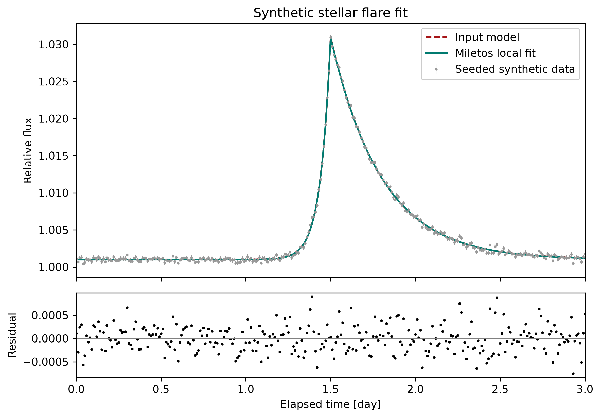

The example spans three days with a flare at day 1.5, peak amplitude 0.03, rise time 0.06 day, decay time 0.3 day, and independent Gaussian flux uncertainty 0.0003. It constrains the flux offset and flare parameters. There are no spots, so the curve contains no information about stellar rotation or spot geometry. Models containing spots use Ephesos's native disk integration with the standard installation.

`select_observed_variable_stars` retains the TESS-sector selection from Hattusa's catalog script. It requires a catalog and aligned zero-or-one coverage rows, with columns representing consecutive sectors starting at Sector 1. The default includes Sector 40 and later. It does not perform a positional cross-match or read machine-specific catalog files.

`run_rotation_regression_benchmark` retains the random-forest period experiment under the optional `rotation_ml` extra. It generates explicitly synthetic sinusoidal curves with periods from 1 to 10 days, independent white noise, and ten random sinusoidal components. Training and test data receive the same noise prescription, and predictions and errors are returned only for held-out targets. This toy noise model does not represent continuous-time stellar variability. The original Hattusa MIT notice is retained in `LICENSE.Hattusa`.

## Mauve data status

Mauve observes stellar UV-visible spectrophotometry over 200-700 nm. Blue Skies
Space distributes selected commissioning observations as FITS files with calibration
information and CALSPEC comparisons through Stardrive. The preview requires an
account. The mission and preview descriptions are at `https://bssl.space/mauve/`
and `https://bssl.space/mauve/preview-data/`.

Miletos can fit a prepared relative-flux series with supplied uncertainties.
The repository has no Mauve FITS reader or instrument-response model, so the
synthetic activity example says nothing about Mauve cadence or precision. A
real-data example needs the product schema and its wavelength, quality, and
uncertainty conventions.

## Installation

```bash
cd /path/to/miletos
python -m pip install -e .
export MILETOS_PATH=/path/to/miletos
```

`MILETOS_PATH` identifies the repository root. Runtime inputs belong under `$MILETOS_PATH/data/` and generated pipeline outputs belong under `$MILETOS_PATH/visuals/`. Both directories are ignored by Git. Miletos does not use a separate data-path environment variable.

Run `python -m pytest -q` from the checkout to execute the tests. The project
uses pytest's importlib mode by default, so test files can share basenames with
files in another checkout when their test directories are run together.

## Minimal usage
Set `MILETOS_PATH` to the repository root and run the deterministic simulated-transit example:

```bash
python examples/simulated_transit/run.py --typefileplot png
python examples/simulated_transit/run.py --bokeh
```

Install `python -m pip install -e '.[bokeh]'` to write the interactive three-stage transit plot as standalone HTML.

The example injects an Ephesos transit into a deterministic simulated light curve, then uses Miletos to mask the transits during spline detrending, phase-fold the result, and calculate uncertainty-aware phase bins. It writes `examples/simulated_transit/visuals/simulated_transit_diagnostic.png`. Use `--typefileplot pdf` for a vector figure.

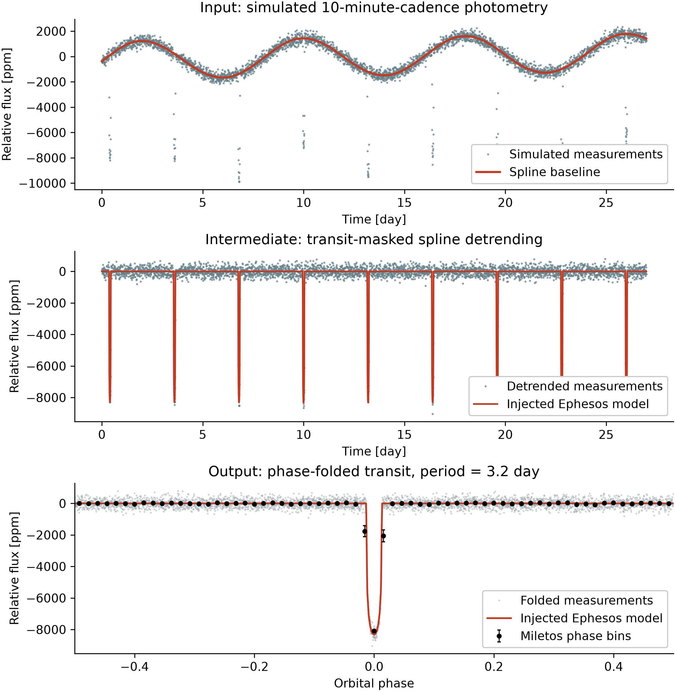

The figure is generated from an explicitly simulated benchmark, not observational data. The reusable API is also available directly:

```python
from pathlib import Path

from miletos.diagnostics import run_simulated_transit_diagnostic

result = run_simulated_transit_diagnostic(Path("visuals/transit_diagnostic.png"))
```

## Examples

Run the complete example set:

```bash
python examples/run_all.py
```

Use `--typefileplot pdf` to generate vector figures.

Each script can also be run separately:

```bash
python examples/simulated_transit/run.py
python examples/compact_object_signatures/run.py
python examples/TOI-1233/run.py
python examples/TOI-1233/run.py --reproduce-daylan2021a --reuse
python examples/WASP-121b/run.py --reuse
python examples/WASP-121b/run.py --prepare-only
python examples/WD1856b/run.py
python examples/TRAPPIST-1/run.py
python examples/WASP-39b/run.py
python examples/TOI-1233/search_single_repeating_origami.py
python examples/tess_transit_search/run_pilot.py
```

The TOI-1233 four-planet fitter keys its posterior cache to the observed
likelihood arrays, model sources, NumPy/SciPy/Batman versions, and sampler
settings. `--reuse` accepts a matching cache. Older caches without this
provenance remain preserved and raise an explicit error. Use
`fit_daylan2021a_transits(..., boolreus=False)` for a fresh fit. The historical
gallery predates this cache format, so current-code comparisons require a new
full posterior.

The equivalent Jupyter notebooks provide interactive access to every maintained
example workflow:

- [Simulated transit](examples/simulated_transit/SimulatedTransit.ipynb)
- [Joint TESS and PFS analysis of TOI-1233](examples/TOI-1233/JointPhotometryRadialVelocity.ipynb)
- [TOI-1233 transits in the context of Daylan et al. (2021a)](examples/TOI-1233/Daylan2021.ipynb)
- [TOI-1233 published-prior setup from Daylan et al. (2021a)](examples/TOI-1233/Daylan2021%202.ipynb)
- [Daylan et al. (2021b) TESS phase curve of WASP-121 b](examples/WASP-121b/Daylan2021b.ipynb)
- [JWST ERS analysis of WASP-39b](examples/WASP-39b/WASP39ERS.ipynb)
- [TESS QLP transit-search pilot](examples/tess_transit_search/TESS_Transit_Search.ipynb)

The notebooks document how to run each workflow and display Miletos-generated
figures. The WASP-39b notebook also records the upstream JWST calibration steps
and a synthetic multi-instrument data example. It distinguishes those documented
steps from Miletos's current implementation.

### TOI-1233 single, repeating, and exomoon searches

Run `python examples/TOI-1233/search_single_repeating_origami.py` to search the cached TESS PDCSAP Sector 10 and 11 light curves. The example uses Miletos BLS to find repeating transit trains, masks their predicted windows, and ranks isolated single-event dips with a weighted box search. It then applies Kipping's [Transit Origami method](https://doi.org/10.1093/mnras/stab2013) to planet b using the saved transit-time-variation (TTV) posterior and scans the moon-to-planet mass ratio.

The run recovers repeating signals near the published periods of planets e, d, c, and b, with two, two, seven, and ten usable events, respectively. No isolated-event peak exceeds the example's SNR 7 screening level. The local-box scores rank events. No false-alarm probabilities have been estimated. The best planet-b TTV sinusoid has $\Delta\mathrm{BIC}=-2.52$ after accounting for the searched TTV period, so the TTV prerequisite for ORIGAMI is unsupported. The highest mass-ratio-grid score is exploratory and does not establish an exomoon. The analysis writes its tables and figures under `examples/TOI-1233/visuals/transit_search/`.


The simulated transit calculation is deterministic and runs without network access. Generic target visibility is maintained in [TDpy's visibility example](https://github.com/tansudaylan/tdpy/tree/master/examples/target_visibility). The WASP-39b notebook documents the NIRSpec PRISM, NIRSpec G395H, and NIRCam F322W2/GRISMR MAST products, the JWST calibration handoff, and seeded synthetic spectrum generation. The maintained observational reproduction downloads the published Alderson et al. (2023) NIRSpec G395H products from Zenodo and visualizes the reduction sequence. Its six figures show detector-level white-light curves, measured detector motion, raw spectroscopic flux with its systematics model, corrected flux with its transit model and residuals, all 349 corrected wavelength channels, residual and photon-noise precision, and the final 344-bin weighted transmission spectrum with its best-fit ATMO model. Data are cached under `$MILETOS_PATH/data/WASP-39/ERS_G395H_Alderson2023/`, while figures are written under `examples/WASP-39b/visuals/`. The source dataset is DOI 10.5281/zenodo.7185300 and the associated Nature article is DOI 10.1038/s41586-022-05591-3.

## Observational results

The gallery below shows representative products generated by the maintained observational workflows. TOI-1233 combines Transiting Exoplanet Survey Satellite (TESS) photometry and Planet Finder Spectrograph radial velocities, WASP-121 b isolates the primary transit and secondary eclipse in the TESS phase curve, and WASP-39 b follows the JWST NIRSpec G395H reduction from detector light curves to the transmission spectrum.

| TOI-1233 joint analysis | WASP-121 b phase curve |
|---|---|
| 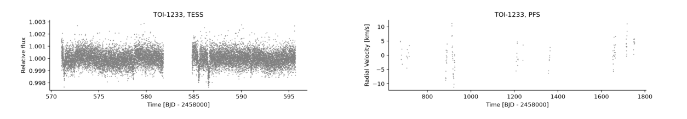 |  |

| WASP-39 b spectroscopic light curves | WASP-39 b transmission spectrum |
|---|---|
| 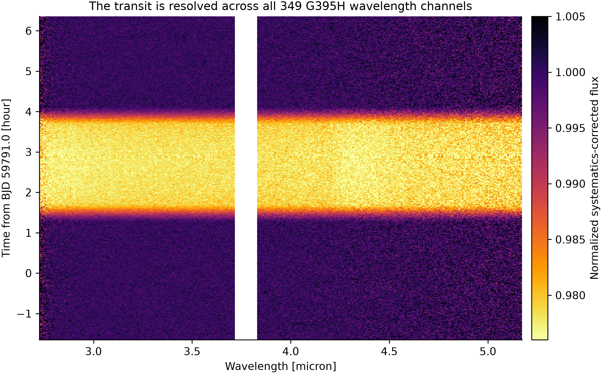 | 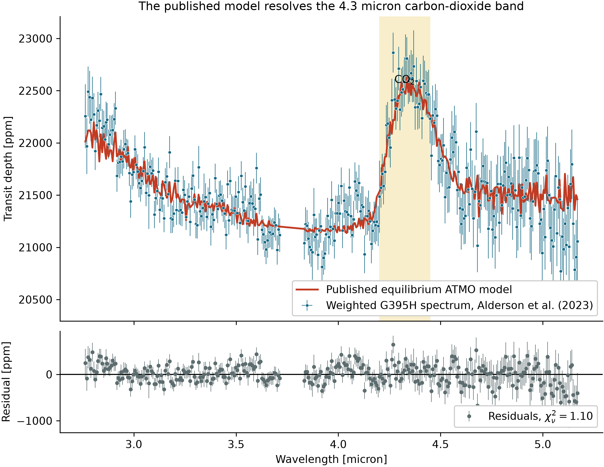 |

The detector-motion and precision panels use the published products of [Alderson et al. (2023)](https://doi.org/10.1038/s41586-022-05591-3). In the retained motion product, `shift_x` and `shift_y` are identical and their unit attributes are empty. These panels preserve the published vectors rather than interpreting them as independent physical pixel shifts. The precision panel retains the published residual scatter and its photon-noise reference.

| WASP-39 b JWST white-light curves | WASP-39 b published motion regressors |
|---|---|
| 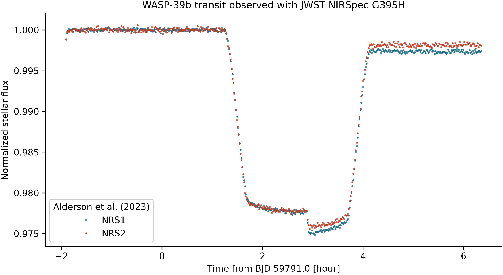 | 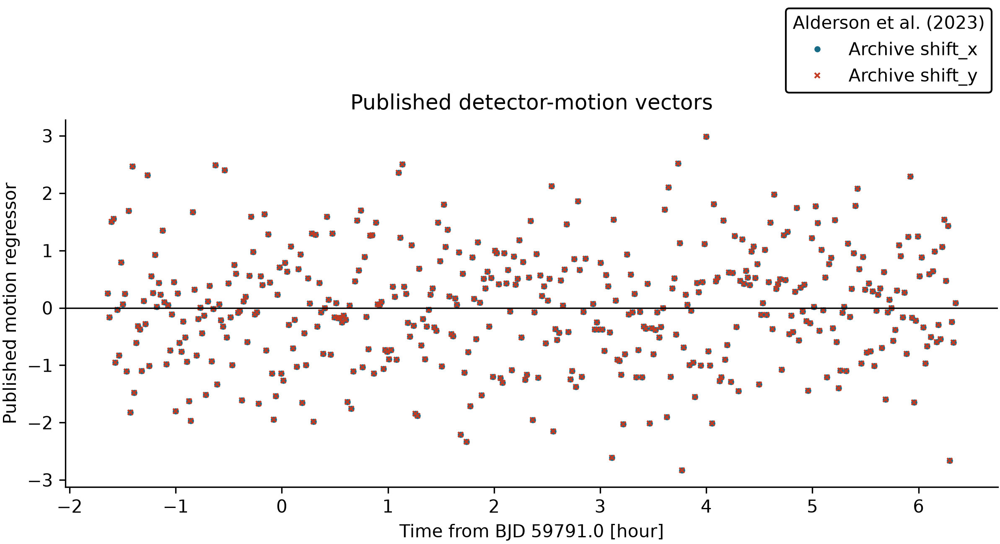 |

| WASP-39 b spectroscopic detrending | WASP-39 b light-curve precision |
|---|---|
| 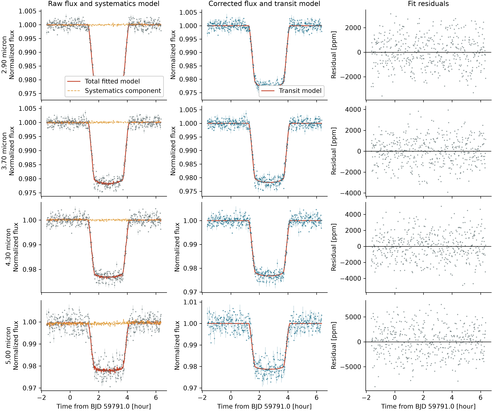 | 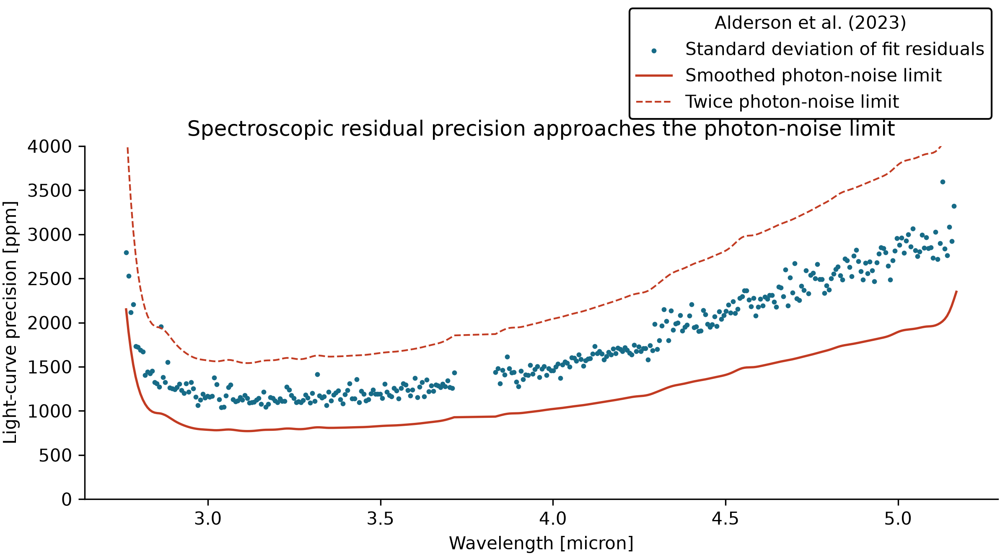 |

| Daylan et al. (2021a) planet-radius recovery | Daylan et al. (2021b) brightness-temperature recovery |
|---|---|
| 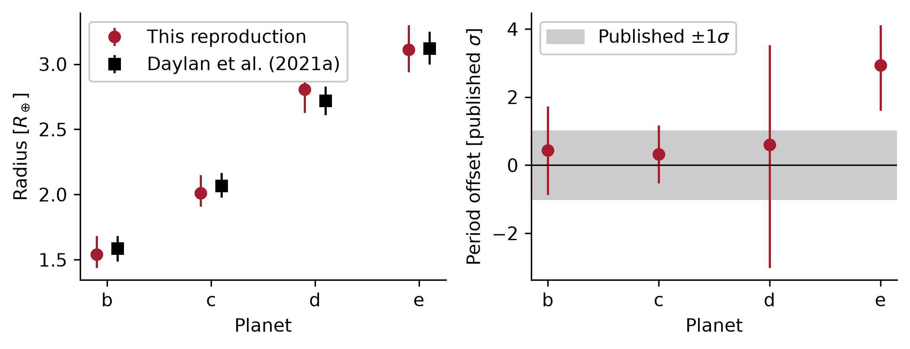 | 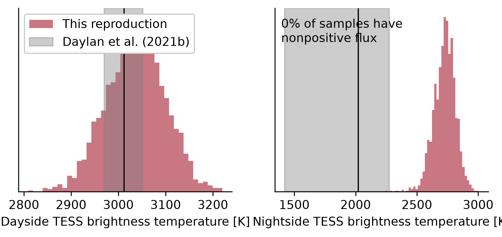 |

| Daylan et al. (2021a) phase-folded transits | Daylan et al. (2021b) fitted phase curve |
|---|---|
| 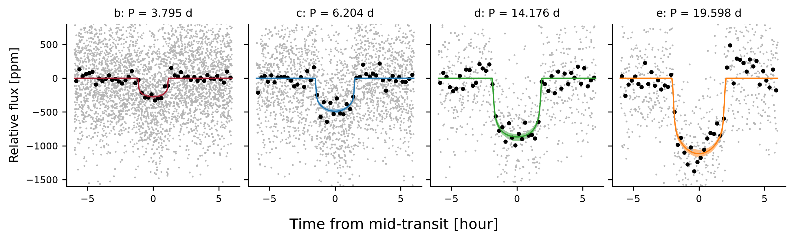 | 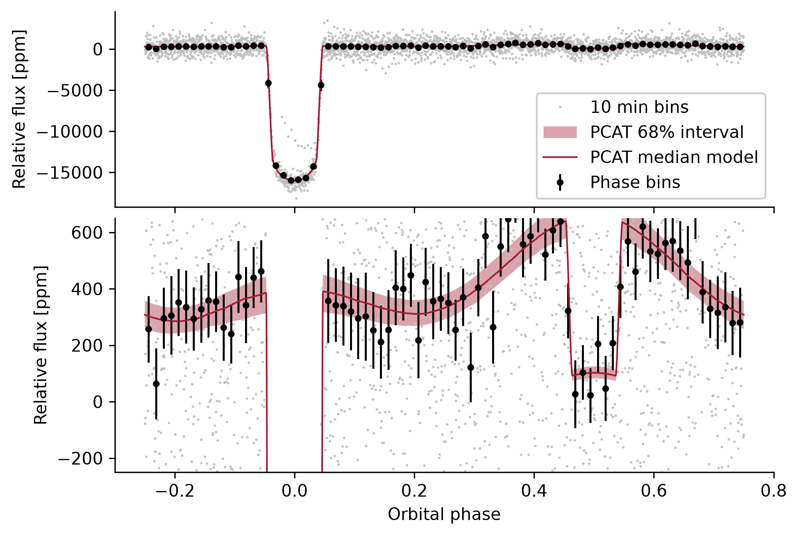 |

Run the joint Transiting Exoplanet Survey Satellite (TESS) and Planet Finder Spectrograph (PFS) analysis of TOI-1233 with:

```bash
python examples/TOI-1233/run.py
```

The default run writes the transit-timing-variation figures to `examples/TOI-1233/PlanetarySystemWithTTVs/visuals/`. Run `python examples/TOI-1233/run.py --model PlanetarySystem` to produce the standard planetary-system alternative. Observational inputs remain under `$MILETOS_PATH/data/TOI-1233/`.

The [2021a notebook](examples/TOI-1233/Daylan2021.ipynb) uses Miletos and PCAT to reproduce the four-planet TESS fit from the published analysis, reusing the cached PCAT posterior when available. It reports posterior radii and periods alongside the published values, then displays the phase-folded transits, parameter comparison, and radius posterior. Run `python examples/TOI-1233/run.py --reproduce-daylan2021a --reuse` to regenerate those figures without resampling. Omit `--reuse` to run four chains with 250,000 burn-in and 150,000 retained samples per chain.

The [2021b notebook](examples/WASP-121b/Daylan2021b.ipynb) reproduces the TESS Sector 7 phase-curve fit with Miletos and PCAT. It uses SPOC SAP photometry after transit-masked, orbit-wise cubic-spline detrending. Its summary compares the dayside modulation amplitude, nightside flux, phase shift, and brightness temperatures directly with the published values. The published −0.022-day shift is converted to degrees for comparison with the PCAT phase parameter. The notebook displays the light-curve fit, phase curve, posterior, and temperature comparison. Run `python examples/WASP-121b/run.py --reuse` to regenerate the fit figures from the saved posterior, or omit `--reuse` for four chains with 100,000 burn-in and 100,000 retained samples per chain. This reproduces the photometric phase-curve analysis, not the external atmospheric retrieval in the published paper.

The [WD 1856 b](examples/WD1856b/run.py) and [TRAPPIST-1](examples/TRAPPIST-1/run.py) examples inspect observed TESS light curves with Miletos, without fitting by default. These observational examples require access to the corresponding public TESS products. The WD 1856 b example also requests orbital priors from the NASA Exoplanet Archive. The broad configuration catalog is maintained separately as a private `tdgu` project.


## Input Data
The input time-series data can include photometry, spectroscopy, radial velocity, or astrometry. Examples are time-series data from the Transiting Exoplanet Survey Satellite (TESS) and JWST, Legacy Survey for Space and Time (LSST), radial velocity surveys such as HARPS, PFS, and NEID.

### TIC 266680498 cached TESS search

Run the Miletos BLS search and candidate vetter on the cached normalized PDCSAP photometry:

```bash
python examples/TIC266680498/run.py
```

The example reads the Sector 3, 30, and 107 CSV products under `$MILETOS_PATH/data/TIC266680498/data/`. It converts their BJD timestamps to BTJD, searches each sector, and writes three figures directly under `examples/TIC266680498/visuals/`. Figure names and the result table now include a UTC timestamp. A JSON record beside the result table preserves the three input SHA-256 hashes and search settings. `--time-tag YYYYMMDD_HHMMSS` selects an explicit tag, and an existing output causes the run to stop before searching. Earlier figures and tables are preserved.

The October 26, 2026 UTC run searched 42,798 observed cadences. Its strongest per-sector periods were 5.98, 6.62, and 7.68 days. The inverted-light-curve check flagged all three peaks, and Sector 30 also showed an odd/even mismatch. Every result remains classified for review. These inputs are cached normalized PDCSAP light curves. The example performs their search and vetting, with raw-pixel extraction outside this workflow.

| Sector 3 | Sector 30 | Sector 107 |
|---|---|---|
| 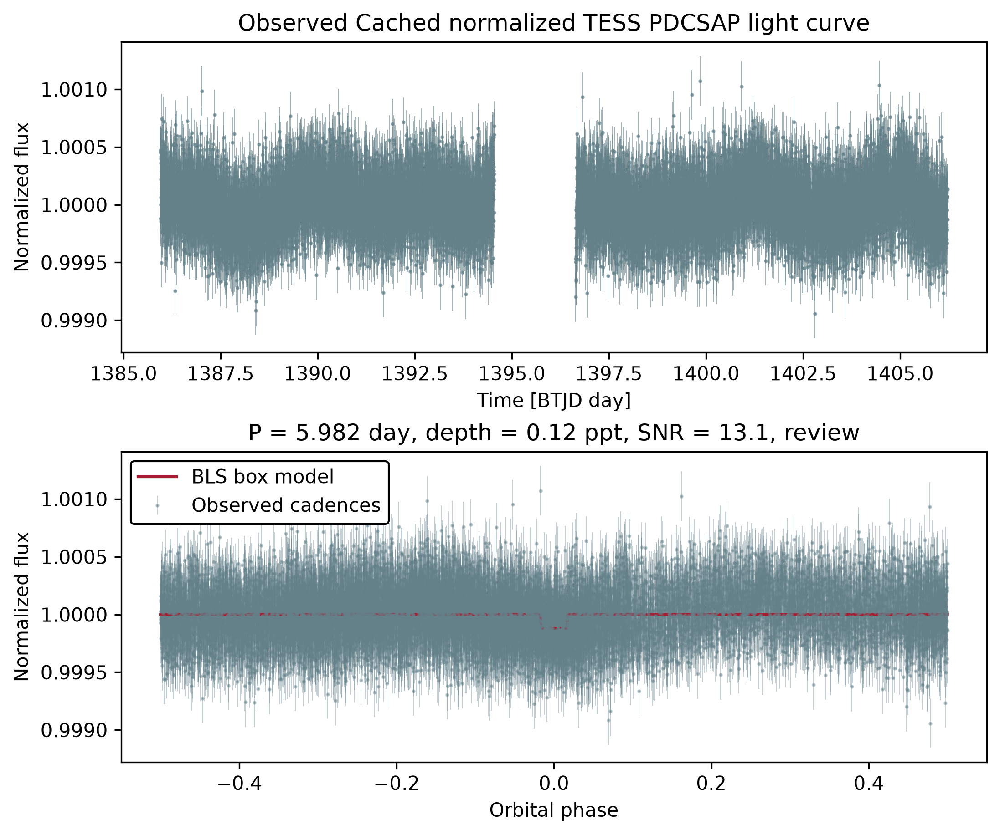 | 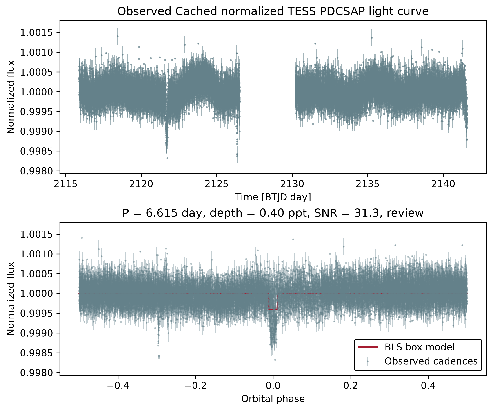 | 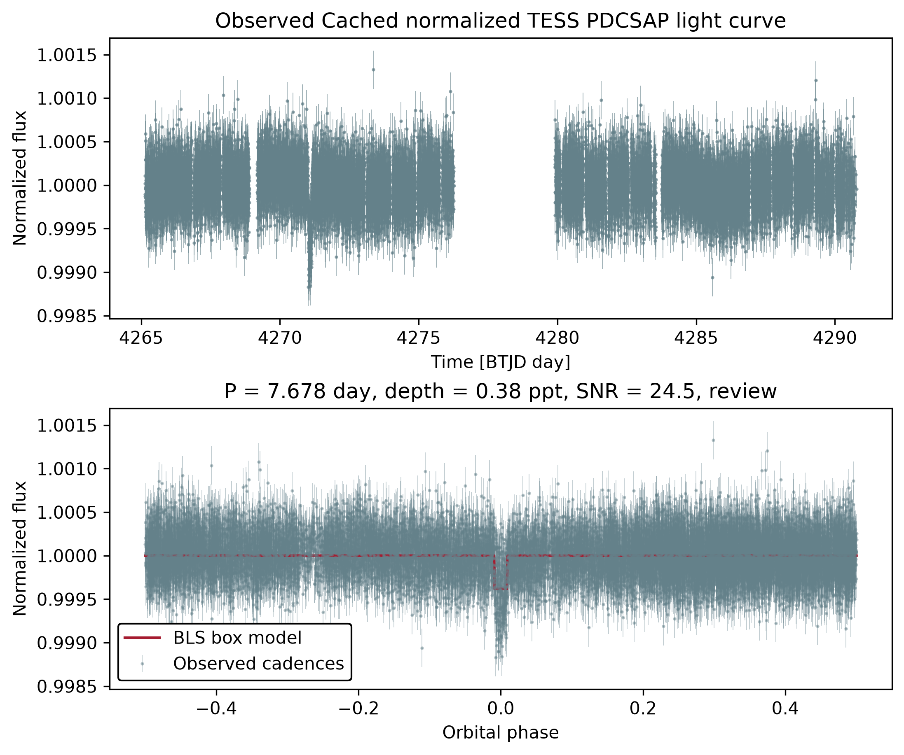 |

To also search the multi-year combined baseline, which takes substantially longer, pass `--include-combined`.

### ULTRASAT synthetic light curves
`miletos.simulate_ultrasat_light_curve` accepts any callable or array-valued relative-flux model and returns columns of JD, noisy relative flux, and flux uncertainty. For example:

```python
import numpy as np
import miletos

data = miletos.simulate_ultrasat_light_curve(
    lambda time: 1.0 + 0.01 * np.sin(2.0 * np.pi * (time - time[0])),
    magnitude=18.0,
    start_jd=2463000.0,
    duration_days=3.0,
    seed=7,
)
```

The default cadence is 300 seconds with a 240-second exposure. Either value can be overridden. The uncertainty uses TDpy's ULTRASAT magnitude-dependent noise model. To generate data inside `miletos.init`, use `listlablinst=[['ULTRASAT'], []]`, `liststrgtypedata=[['simutargpartsynt'], []]`, and `dictsimu={'ULTRASAT': {'start_jd': 2463000.0, 'duration_days': 3.0, 'cadence_seconds': 300.0, 'exposure_seconds': 240.0}}` with a target identifier or coordinates and its source model in `dicttrue`. For systems without NASA Exoplanet Archive priors, set `typepriocomp='inpt'` and provide the companion-prior inputs.

The five priors are `rratcompprio`, `rsmacompprio`, `epocmtracompprio`,
`pericompprio`, and `cosicompprio`. Supply each as a one-dimensional list or
array of finite, unmasked real values. All five must have equal lengths.


### Aperture photometry from Lygos images

`miletos.light_curve_from_image_stack(stack, aperture)` converts a supplied Lygos
`ImageStack` into Miletos time, relative-flux, and uncertainty columns. Install
`miletos[photometry]` for Lygos. The aperture must be a nonempty Boolean pixel
mask. For a stack with a WCS, `stack.pixel_of(target_coordinate)` locates an
arbitrary supplied sky coordinate for `stack.circular_aperture`.

```python
good_stack = stack.select(stack.quality == 0)
aperture = good_stack.circular_aperture(2.0, center=good_stack.pixel_of(target_coordinate))
data = miletos.light_curve_from_image_stack(good_stack, aperture)
```

The adapter calls Lygos aperture photometry and divides flux and propagated error
by the same positive median. `normalize=False` retains the stack's flux units.
Times keep their original epoch and time system. Pixel uncertainties are required
and combined in quadrature as independent errors. The caller must subtract any
background beforehand and account for uncertainty in that estimate. The adapter
uses only the supplied pixel errors. Invalid aperture pixels and remaining quality
flags are rejected. No detector response or noise model is inferred from a mission
label.

Pass the returned array to `miletos.search_box_least_squares` with period and
duration ranges. A synthetic Lygos image cube with an injected 1.2-day box
transit recovers the period to within one sampling cadence. It uses independent
Gaussian pixel errors and an illustrative source profile. The example contains
no ULTRASAT observation or instrument-response measurement.

## Data gathering
Given a target, Miletos searches for time-series data using MAST (e.g., TESS, Kepler, HST, and JWST).

CHEOPS public light curves are retrieved through the optional DACE client. Install `miletos[cheops]`, then call `miletos.retrieve_cheops_light_curves("WASP-8")` or pass `ra_deg` and `dec_deg` to resolve the nearest CHEOPS target. The function returns one normalized `[BJD, flux, flux uncertainty]` array per visit, keyed by DACE `file_key`. Its default quality filter follows the standard CHEOPS event-flag limits. To retrieve directly in `miletos.init`, set `listlablinst=[['CHEOPS'], []]`, `liststrgtypedata=[['obsd'], []]`, and provide `strgmast`, `ticitarg`, or coordinates. Set `cheopsaperture` to select the DACE photometric aperture. Public data do not require a DACE API key. Private data require DACE credentials.

On October 25, 2026, the three public selectors below each returned the same
eight WASP-189 visits and 13,886 usable cadences with DACE client 3.0.2.
Visit times were strictly increasing, uncertainties finite and positive, and
the arrays agreed exactly across selectors. Normalization sets each visit's
median flux to one. Instrumental detrending and astrophysical fitting remain
separate steps.

```python
import miletos

by_name = miletos.retrieve_cheops_light_curves("WASP-189")
by_tic = miletos.retrieve_cheops_light_curves(157910432)
by_position = miletos.retrieve_cheops_light_curves(
    ra_deg=225.686732, dec_deg=-3.0314874,
)
```


## Analyses
Miletos performs preliminary analyses such as detrending, phase-folding, producing Lomb-Scargle periodograms (via Astropy), and performing Box Least Squares (BLS) searches. The outcomes are plotted, written to disk, and returned to the user. They are also used as priors for subsequent generative modeling of the data.

For additional physical and structural checks of raw time series, companion orbital parameters, photometric model fluxes, and phase-folded products, pass `boolsanity=True` to `miletos.init`. These checks are off by default and leave the existing `booldiag` behavior unchanged.

For direct BLS searches, `miletos.search_box_least_squares(...)` accepts strictly increasing `time_days`, `flux`, matching positive `flux_uncertainty`, a grid of trial `duration_days`, and minimum and maximum periods. It returns the highest-SNR period, transit time, duration, depth, depth uncertainty, and the full Astropy periodogram.

To animate a BLS scan, call `miletos.animate_box_least_squares_search` with a mapping from labels to `[time, flux, uncertainty]` arrays, period bounds, trial durations, and a GIF output path. The animation shows each light curve's growing BLS score curve alongside its best-so-far folded box model.

The [BLS runtime example](examples/bls_performance/run.py) measures the maintained Miletos search over a seeded, synthetic 27-day light curve with a 3.2-day, 1% box transit and 0.1% independent Gaussian noise. It varies cadence count and Astropy's `frequency_factor`, then writes the measured times and a two-panel figure directly under `examples/bls_performance/visuals/`.

```bash
python examples/bls_performance/run.py
```

Use `--cadences` and `--frequency-factors` to choose another benchmark grid. Timings vary with the machine and environment. This synthetic benchmark reports run time for the selected settings and does not predict observational performance.

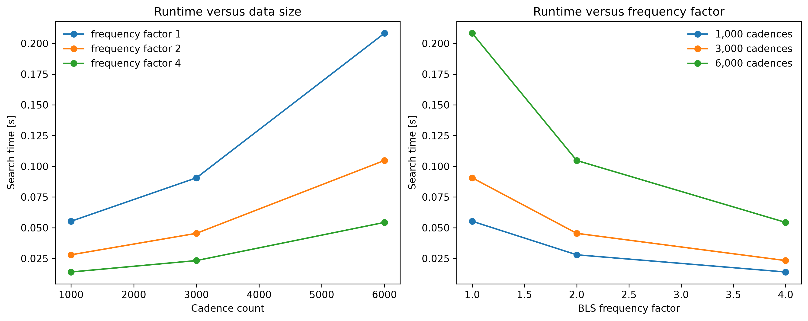

### Compact-object photometric signatures

I route compact-object Doppler-beaming, ellipsoidal-variation, and self-lensing
amplitudes through Ephesos. The example compares those predictions across
orbital periods and companion masses for a solar-type source star.

`derive_compact_object_features` passes a density consistent with the supplied
stellar mass and radius to Ephesos, using the same 1.41 g cm^-3 solar
normalization as the amplitude prescription. Masked, complex, nonfinite, or
nonpositive inputs are rejected before computing that density. Complex arrays
are rejected even when their imaginary components are zero. Fully unmasked real
containers remain supported. These are model predictions. Measured
amplitudes require fitting observed light curves.

Run the example with

```bash
python examples/compact_object_signatures/run.py
python examples/compact_object_signatures/run.py --bokeh
```

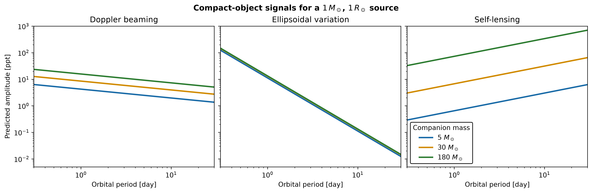

Pass `typeplotback='dark'` to the BLS animation, simulated-transit renderers,
or WASP-39 figure functions for black backgrounds with white axes. Otherwise
these renderers inherit an enclosing TDpy `plot_style()` theme and use white
backgrounds with black axes outside such a context. `miletos.init` and its
existing time-series entry points also accept the background selection and
restore the caller's plotting settings when they return.

`miletos.visualization.plot_binned_light_curve` draws measurements as
unconnected error-bar markers. Its default is black in a white theme and white
in a dark theme. An explicit `color` keeps caller-selected instrument or
population colors, without changing the supplied coordinates or uncertainties.

### TESS QLP transit search and vetting

Miletos includes a batch TESS transit search built on its Astropy BLS interface. It queries exact TIC identifiers and sectors for public Quick-Look Pipeline (QLP) products at MAST, quality-filters and normalizes FITS light curves, searches for periodic transit-like signals, and records odd-even, secondary-phase, and inverted-light-curve null-test results. Candidates that fail a metric remain under review. Vetting also needs pixel-level validation, centroid analysis, dilution analysis, and human follow-up.

Prepare a CSV with `tic_id` and `sector` columns, plus optional `tmag`, `toi`, `reference_disposition`, and `sample_is_parent_population` columns, then run:

```bash
python -m miletos.tess_transit_search --catalog path/to/targets.csv
```

Add `--typeplotback dark` to select dark backgrounds for all search-product
figures. The target and survey plotting functions accept the same option
from Python without changing the search results or input tables.

Occurrence inputs require one row per unique TIC and one finite completeness fraction between zero and one per TIC, period, and depth cell. Repeated sector rows must be combined into a justified per-target selection model before estimating occurrence. Parent-sample, searched, and detection flags must be Boolean or numeric 0/1. For the inverted-light-curve null test, dispositions must be `candidate` or `review`. Missing values, duplicate injection cells, and injection targets outside the parent sample are rejected before Pergamon is called.

The pipeline writes target results, injection recoveries, and separate search-yield, completeness, inverted-signal-null, TESS-magnitude, and TOI-disposition figures. The inverted null uses the same period-duration grid as the observed flux. Injection recovery reruns the full search and odd-even/secondary vetter. Injected dimmings skip the inverted-data null test because they would appear as positive events by construction. Downloaded FITS products are cached under `$MILETOS_PATH/data/tess_transit_survey/`. Use `--offline --data-directory PATH` to rerun from a retained cache. `--maximum-targets` limits a development run, and `--injection-trials` sets randomized epochs per injected period-depth cell.

The observed pilot analyzes TOI 1338.01 (TIC 260128333), Sector 10, with archived TESS magnitude 11.4881. The QLP curve contains 950 quality-screened cadences over 24.916 days. The strongest positive-flux BLS box is at 7.3549 days, with depth 1.428 ppt and SNR 6.77. The full-grid inverted-signal null test peaks at SNR 8.56, and the target remains under review. In the earlier retrospective Sector 10 validation of 49 known TOIs, 48 have QLP searches, 17 pass the initial screen, and 31 remain for review. Twenty-three of 48 targets also pass the remaining triage metrics with an inverted signal. This fraction is specific to that test and does not estimate a false-discovery rate. The October 26, 2026 UTC pilot rerun uses eight randomized epochs per injection cell with seed 0. For 3-day, 0.1-day-duration injections, full-search and vetter recovery is 0/8 at 0.3 and 0.5 ppt, 6/8 at 1 ppt, 7/8 at 10 ppt, and 8/8 at 2, 5, and 20 ppt. The one-target intervals are wide. These results do not measure survey completeness or planet detection rate.

| Observed search and phase fold | Pilot injection completeness |
|---|---|
| 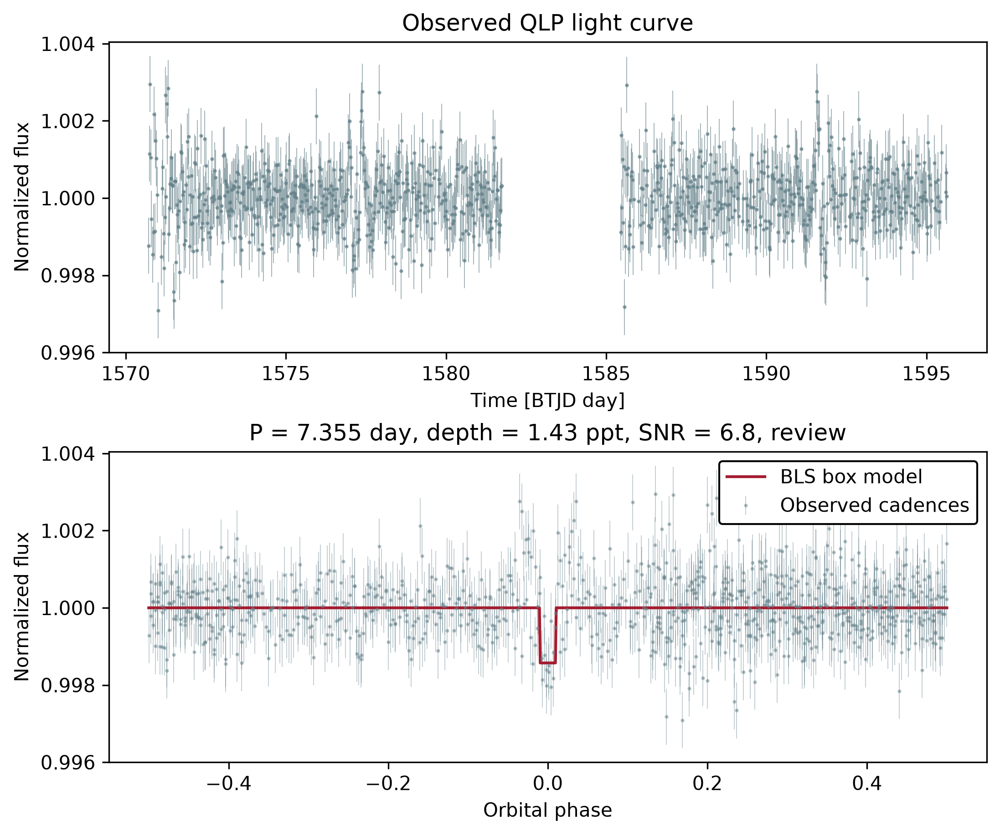 | 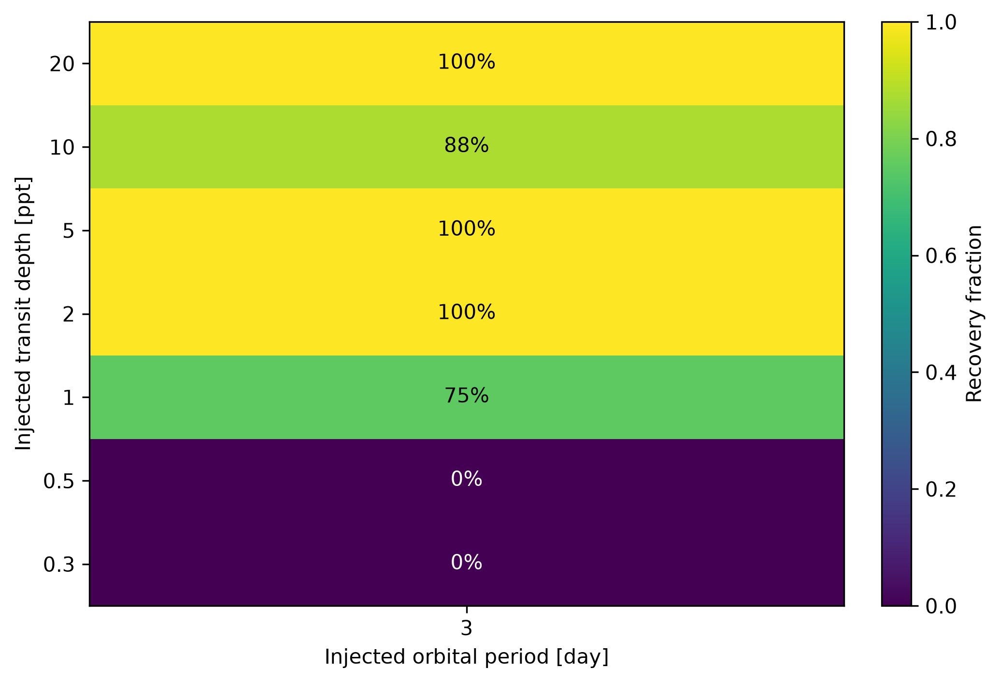 |

The TESS Faint-star Search reported 1,617 TOIs from 14,849,252 Primary Mission stars searched by QLP (Kunimoto et al. 2022). The published counts and the Miletos validation use different samples and selection rules, so their totals cannot be compared on a common denominator. The helper `prepare_toi_target_list` selects sector- and magnitude-limited validation subsets from an ExoFOP table. The Sector 10 validation uses the archived 2020-09-16 snapshot and selects 50 TOI entries on 49 unique TICs with TESS magnitudes 10.5--13.5. Run `python examples/tess_transit_search/run_toi_validation.py` to reproduce from cached products, or add `--download` to retrieve missing products. This subset was selected from previously identified TOIs and supports validation, not an occurrence-rate estimate. Miletos passes completeness and inverted-signal null results to Pergamon only when every row belongs to a declared complete parent population, every target has a usable search, and the injection grid is complete. The injection grid gives every cell equal weight by default. Supply `injection_grid_weights` for a different occurrence domain. The random QLP parent-sample builder in `examples/tess_transit_search/run_sector10_survey.py` remains experimental. It has yet to produce a validated survey sample at scale. See the [TESS search and vetting guide](docs/transit_search.rst) and [API reference](docs/api.rst).

The [TIC 38455598.1 exocomet-candidate example](examples/TIC38455598_exocomet/run.py) runs QLP FaintStar BLS vetting across Sectors 8, 35, 62, 89, and 99, fits a linear ephemeris to the recurrent Sector 8, 62, and 89 events, and compares Ephesos opaque-disk and trailing dust-tail models. Run it with `MILETOS_PATH` set to this repository and `--offline` to use cached QLP files. Figures are written directly to `examples/TIC38455598_exocomet/visuals/`. Candidate and model tables are stored under `$MILETOS_PATH/data/TIC38455598/`. Both fits minimize weighted chi-square, and their BIC values use independent Gaussian binned-flux errors with two disk parameters or six dust-tail parameters. The fixed stellar properties and limb-darkening coefficients are modeling assumptions. The dust-tail model is phenomenological and provides no evidence of an exocomet detection.

Pass `--cache-directory PATH` to read QLP products from another cache without changing `MILETOS_PATH`. Without that option, the example uses `$MILETOS_PATH/data/TIC38455598/qlp_cache/`.

| TIC 38455598.1 Sector 62 FaintStar vetting | Ephesos opaque-disk and dust-tail comparison |
|---|---|
| 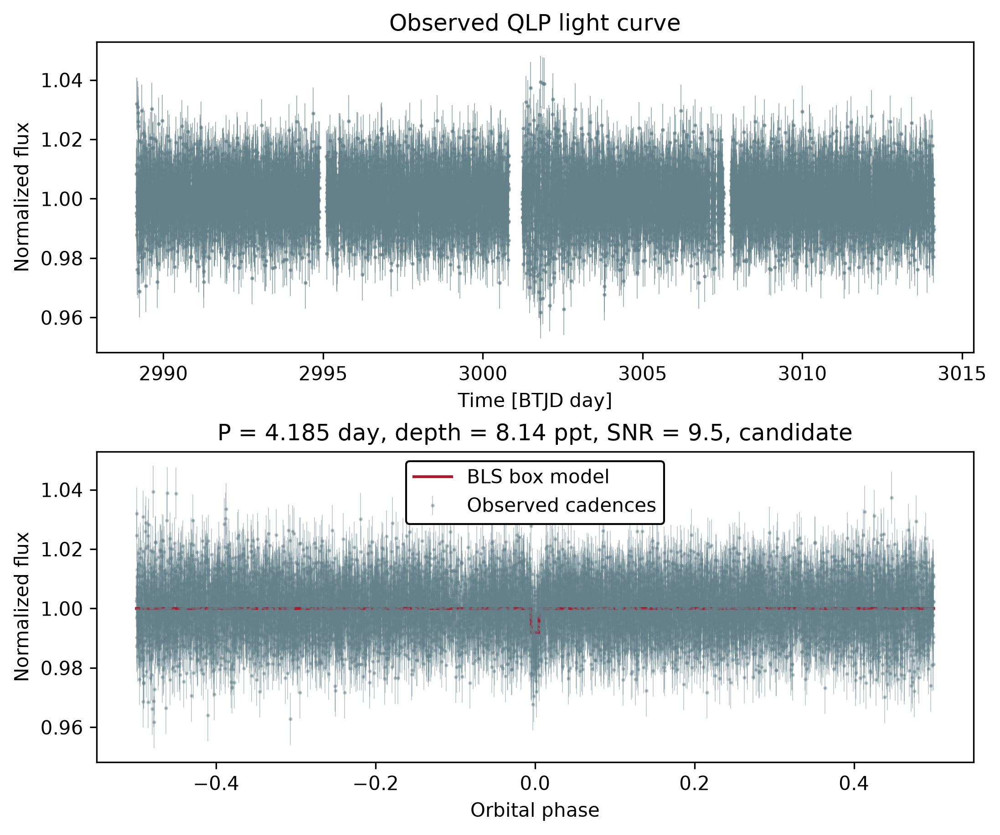 | 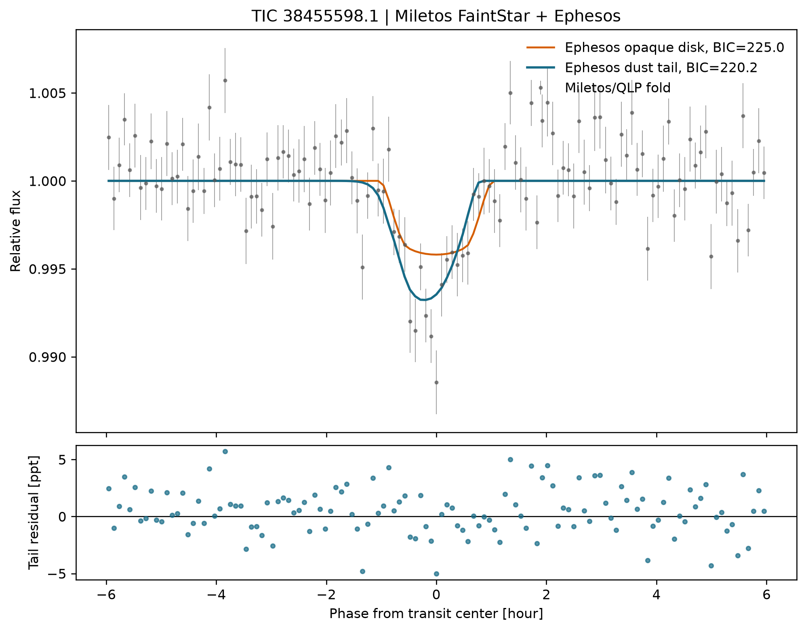 |

### Rubin Data Preview transit search

`miletos.rubin_transit_search` can query one object's forced photometry from Data Preview 1 or Data Preview 2 through an authenticated Rubin Science Platform TAP service. `prepare_rubin_light_curve()` applies PSF-flux flags when the release schema provides them. If the flag column is absent, no flag-based filtering is possible. It converts visit times to barycentric Julian dates in the TDB time scale and normalizes each filter by its median flux. `search_rubin_target()` ranks repeating-transit BLS candidates independently by filter and requires at least three observed transits. Its returned candidates are marked `unvetted`. This workflow does not yet provide transit vetting or survey-completeness estimates. The Rubin client is available only inside an authenticated environment with `lsst.rsp` installed.


## Model
Miletos uses Bayesian forward models and PCAT to sample posterior distributions under configured priors and likelihoods. Assess convergence for each run because sampling adequacy depends on the analysis. [Ephesos](https://github.com/tansudaylan/ephesos) provides models of flaring or spotted stars with stellar, compact, or planetary companions, as well as exploding stars with companions.

Miletos allows the user to marginalize over the model parameters, including those that characterize limb darkening using an parametrization that is efficient to sample from (Kipping 2013).


### red noise
Real data, unlike many simulations I run, contain features that my fitting models do not explain. I use Gaussian Processes (GP), as implemented in [celerite](https://github.com/dfm/celerite) (Foreman-Mackey et al. 2017), to model time-series baselines and red-noise systematics with minimal degeneracy against the signal of interest.


### priors
In order to determine the priors on the model parameters, Miletos either performs fast analyses on the time-series or fetches those priors from relevant databases.

When modeling exoplanetary systems (e.g., known exoplanets or TESS Objects of Interest) Miletos can either perform a box least squares (BLS) search to find candidates of transiting exoplanets and perform an Lomb-Scargle search to find radial-velocity candidates, querry the NASA Exoplanet Archive or the TOI catalog, respectively, to retrieve priors on the epoch of mid-transit time and orbital period.


## Performance
Forward-model evaluations dominate the runtime and can use just-in-time compilation or graphics processing units for acceleration.


## Usage

### JWST Early Release Science (ERS)

Miletos analyzes extracted JWST time-series spectra. Its general MAST path selects public CALJWST Level 3 `x1dints` products. Its G395H reader keeps NRS1 and NRS2 wavelength solutions separate. Miletos does not run Detector1, Spec2, or TSO3 and is not a substitute for the JWST calibration pipeline. The example below documents the full upstream reduction and identifies which instrument-specific steps still need validation before treating PRISM or NIRCam products as a maintained Miletos reduction.

When fitting spectral light curves over a wavelength interval, limb darkening and its wavelength dependence must be accounted for. This is particularly important for broad-coverage PRISM data.


### JWST ERS Observations of WASP-39b

The [WASP-39b example notebook](examples/WASP-39b/WASP39ERS.ipynb) documents the public ERS transit visits and the complete data path. MAST lists these Stage 3 spectroscopic products:

| Mode | MAST observation ID | Configuration | Products |
|---|---|---|---|
| NIRCam grism | `jw01366-o002_t001_nircam_f322w2-grismr-subgrism256` | F322W2 / GRISMR / SUBGRISM256 | `_x1dints.fits`, `_whtlt.ecsv` |
| NIRSpec G395H | `jw01366-o003_t001_nirspec_f290lp-g395h-s1600a1-sub2048` | F290LP / G395H / S1600A1 | `_x1dints.fits`, `_whtlt.ecsv` |
| NIRSpec PRISM | `jw01366-o004_t001_nirspec_clear-prism-s1600a1-sub512` | CLEAR / PRISM / S1600A1 | `_x1dints.fits`, `_whtlt.ecsv` |

For a reduction from raw exposures:

1. Query MAST for WASP-39 and proposal 1366. Confirm the visit, exposure segments, and product names. Download all `*_uncal.fits` exposures and preserve the association and visit metadata.
2. Pin a JWST pipeline release and CRDS context. Configure `CRDS_PATH`, `CRDS_SERVER_URL`, and `CRDS_CONTEXT` and record their values with the reduction products.
3. Run Detector1 on each uncalibrated integration file. It applies detector-level corrections and ramp fitting and produces TSO `*_rateints.fits` products.
4. Run Spec2 on each `rateints` product with the same pipeline and CRDS context. Inspect data-quality flags, unstable or saturated integrations, background subtraction, trace limits, wavelength solutions, and residual detector systematics. The outputs are calibrated integrations, commonly named `*_calints.fits`.
5. Create a TSO3 Level 3 association for each visit containing its calibrated integration segments, then run TSO3. For these spectroscopic visits, inspect the resulting `*_x1dints.fits` and `*_whtlt.ecsv` products, timestamps, wavelength arrays, flux units, uncertainties, DQ values, and segment boundaries.
6. Apply instrument-specific checks before extraction or fitting. For PRISM, inspect the broad trace and wavelength-range edges. For G395H, retain NRS1 and NRS2 separately, inspect their overlap and detector gap, and combine only after checking their wavelength solutions and residuals. For NIRCam F322W2/GRISMR, inspect the grism trace, background, 1/f residuals, and contamination or order behavior.
7. Pass extracted time-series spectra into Miletos for quality filtering and light-curve analysis. The G395H reader has detector-specific NRS1/NRS2 handling. The general MAST code reads `x1dints`. Validate PRISM and NIRCam against the exact files and instrument settings before relying on those workflows. This example documents upstream reduction steps. Miletos does not yet provide maintained raw-to-spectrum reductions for these modes. Preserve instrument labels and wavelength-bin covariance for joint atmospheric interpretation.

The notebook's final cell generates reproducible synthetic spectra on separate PRISM, G395H, and NIRCam wavelength grids. Broad water-like bands, a narrow HDO-like feature, and seeded noise levels are illustrative assumptions. The noise does not reproduce instrument performance, and the spectra are not observed WASP-39b data. For a covariance-aware PCAT injection/recovery, see [`examples/nirspec_isotope_retrieval/run.py`](examples/nirspec_isotope_retrieval/run.py).

Run the maintained published-product G395H reproduction with:

```bash
python examples/WASP-39b/run.py --typefileplot png
```

The example uses the public products accompanying Alderson et al. (2023), including the raw NRS1 and NRS2 white-light curves, the fitted 349-channel spectroscopic light curves, the weighted transmission spectrum, and the published equilibrium ATMO model. Miletos recomputes the archived systematics correction and residual identities before plotting. Representative 2.9, 3.7, 4.3, and 5.0 micron channels expose the raw flux, systematics component, corrected flux, transit model, and fit residuals without replacing the observations or generating hundreds of repetitive panels. The example also reports the directly recomputed atmospheric-model goodness of fit.

### Observed pulse in TIC 380907942

[Sorabella et al. (2026)](https://doi.org/10.3847/1538-4357/ae25f8) examined a nearly symmetric brightening in this single-lined binary. The paper links its Sector 30 QLP photometry through [MAST DOI 10.17909/mrrv-4980](https://doi.org/10.17909/mrrv-4980).

```bash
python examples/TIC380907942/run.py --download
```

Use `--input PATH` for an exact retained QLP FITS file. The example applies
Miletos's quality mask and compares the reader's default `KSPSAP_FLUX` with
independently median-normalized `SAP_FLUX`. In this product, the broad pulse is
visible in `SAP_FLUX` and strongly suppressed in `KSPSAP_FLUX`. The optional
reader argument `include_aperture_flux=True` adds aperture flux while leaving
the default flux/error pair used by transit searches unchanged.

The zoom shows arithmetic means of six consecutive retained cadences, with population standard deviations (`ddof=0`) as error bars. This explicitly chosen convention follows the paper's six-point and standard-deviation description, which does not specify `ddof`. The final five cadences remain in the raw table rather than becoming an incomplete six-point bin. The archive product has no `SAP_FLUX_ERR`, so per-cadence aperture errors are not invented or borrowed from the detrended series.

Each run writes timestamped raw and binned CSVs plus a provenance manifest under
`data/TIC380907942/`. The figure is saved under the example's `visuals/` folder.
The manifest records the input and source hashes, cadence counts, binning
definition, and output file. Both PNG and PDF are supported, along with white
and dark themes. Earlier outputs remain unchanged.

This example reproduces the observed photometric feature, not the joint light-curve and radial-velocity posterior. The paper uses archival CfA Digital Speedometer velocities, a nonzero-eccentricity model, and long posterior chains. That time series and the joint inference have not been reproduced here. No self-lensing confirmation is claimed.

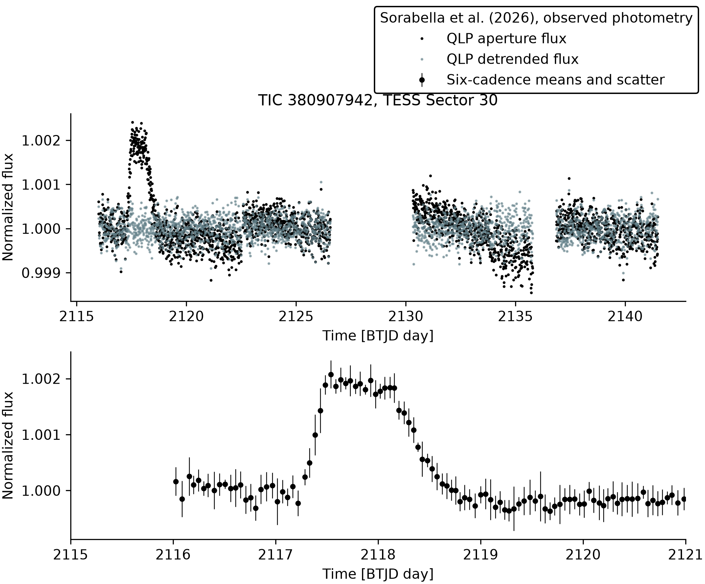

### PCAT-backed NIRSpec spectral retrievals

`miletos.retrieval.sample_nirspec_retrieval()` samples a fixed-dimensional posterior with PCAT for wavelength-binned transit depths and a full depth-covariance matrix. Supply a forward-model callback that returns one predicted depth in ppm per wavelength bin. Its parameter vector can include `log10_hdo_h2o`, D/H, or other isotopic abundances.

```python
from miletos.retrieval import sample_nirspec_retrieval

chain, log_probability = sample_nirspec_retrieval(
    wavelength_microns,
    transit_depth_ppm,
    covariance_ppm2,
    forward_model=isotope_aware_transmission_model,
    parameter_names=("log10_hdo_h2o", "temperature_kelvin", "cloudtop_log10_pa"),
    prior_types=("self", "gaus", "self"),
    prior_minima=(-12.0, 500.0, -2.0),
    prior_maxima=(-2.0, 2000.0, 6.0),
    prior_means=(0.0, 1200.0, 0.0),
    prior_stdvs=(1.0, 200.0, 1.0),
    initial_values=(-6.0, 1200.0, 2.0),
    proposal_scales=(0.1, 0.05, 0.05),
)
```

The forward model supplies isotope-specific opacity data and spectral binning. Miletos supplies the covariance-aware Gaussian likelihood and PCAT sampling. Domain-specific exceptions for unphysical model states can be passed through `model_error_types` and are treated as rejected proposals. The self-contained HDO injection-recovery example is synthetic and is not an observational deuterium detection. The published WASP-39b ERS spectrum is available through `miletos.ers.analyze_wasp39_ers_g395h()` as a real NIRSpec data source for an isotope-aware forward model.

Run the synthetic injection-recovery example with:

```bash
python examples/nirspec_isotope_retrieval/run.py
```

Each run writes a timestamped figure and saves the actual samples, correlated synthetic observations, covariance, model intervals, and source hash under `data/nirspec_isotope_retrieval/`. Existing outputs are preserved. Use `--typeplotback dark` for dark output or `--typefileplot pdf` for PDF. Masked or complex observations, covariance, and numeric prior inputs are rejected rather than converted to their hidden real values.

Gaussian feature shapes supply this toy spectrum. The single short chain has not been assessed for convergence. Estimating real isotope sensitivity requires molecular opacities and instrument responses.

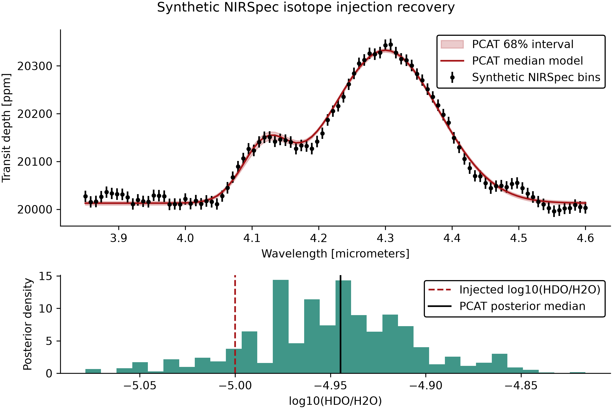


### TESS Observations of WASP-121b

Here is an example usage of Miletos for analyzing the TESS data on an ultra-hot Jupiet, WASP-121b.

```
def cnfg_WASP0121():

    # a string that will appear as the base of the file names
    strgtarg = 'wasp0121'

    # a string that will be used to search for data on MAST
    strgmast = 'WASP-121'

    # a string for labeling the target in the plots
    labltarg = strgmast

    # a string indicating the TOI number for querying initial conditions
    strgtoii = '495.01'

    # also do a phase curve analysis
    boolphascurv = True

    # call Miletos
    Miletos.main( \
                 strgtarg=strgtarg, \
                 strgmast=strgmast, \
                 labltarg=labltarg, \
                 strgtoii=strgtoii, \
                 boolphascurv=boolphascurv, \
                )
```

You can find more example uses of Miletos under the examples folder.
